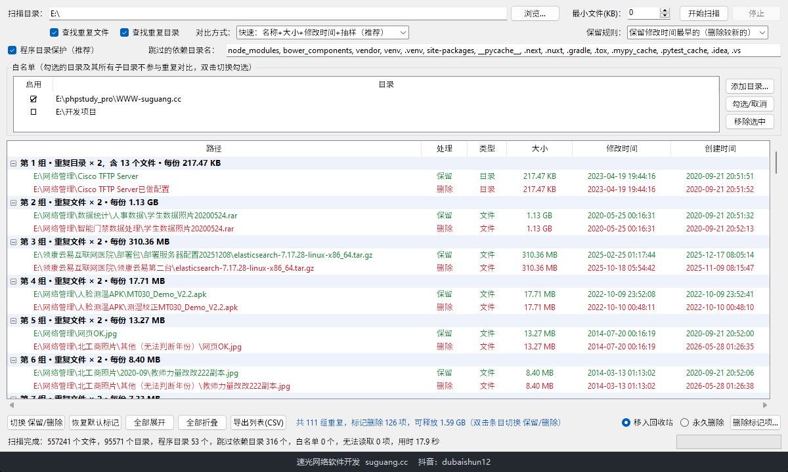
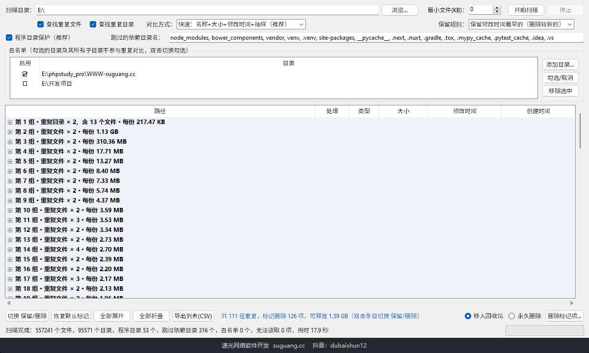

# 重复文件及目录清理工具

一款 Windows 图形界面工具：找出磁盘上的**重复目录**和**重复文件**，按"保留最早的一份、删除较新的副本"给出清单，**确认后才删除**，默认移入回收站可随时还原。

像人工整理一样工作：先看目录，不碰程序；代码项目、网站、软件、数据库内部的文件绝不单个拆删。



---

## 功能特点

| 功能 | 说明 |
|---|---|
| 重复目录 | 整个目录（含所有子目录）完全相同才算重复，只报告最上层的重复目录，其内部内容不再重复列出 |
| 重复文件 | 名称不同但内容相同的文件也能找出 |
| 快速对比（默认） | 按"目录结构 + 文件名 + 大小 + 修改时间"判断，再抽样校验文件首尾，如E 盘 55 万文件约 6 分钟（二次扫描约 20 秒） |
| 精确对比 | 逐个完整校验文件内容，最严谨但较慢 |
| 程序目录保护 | 自动识别代码项目、网站、App、软件/游戏、数据库、服务部署目录，内部不做任何拆分删除 |
| 依赖目录跳过 | `node_modules`、`vendor`、`venv`、`site-packages`、`__pycache__` 等直接跳过，不遍历不对比 |
| 白名单 | 勾选的目录及其所有子目录不参与对比，可随时勾选/取消，自动保存 |
| 先列表后删除 | 每组绿色"保留"、红色"删除"，双击可切换；支持导出 CSV 核对 |
| 安全删除 | 默认移入回收站；永久删除需二次确认；每组至少保留一份 |

---

## 下载与运行

- **直接运行**：双击 `dist\重复文件清理工具.exe`，无需安装 Python。
- **源码运行**：需要 Python 3.8+（自带 tkinter，无第三方依赖）

  ```bash
  python dup_finder.py
  ```

## 使用步骤

1. **选择扫描目录**（默认 `E:\`），按需添加白名单目录。
2. 点击 **开始扫描**，扫描过程中可随时 **停止**。
3. 查看结果列表：每组一份 **保留**（绿色），其余 **删除**（红色）。
   - 双击条目切换 保留/删除；每组至少保留一份。
   - 可切换"保留规则"：按修改时间或创建时间保留最早的一份。
   - 可点 **导出列表(CSV)** 用 Excel 核对。
4. 确认无误后点 **删除标记项…**，默认 **移入回收站**。



---

## 判断规则

### 1. 什么算"重复"

**快速模式（默认，推荐）**——和人工看目录的方式一样：

- **目录**：所有子目录名、文件名、文件大小、修改时间全部一致 → 重复；
  另外对每个目录中**最大的 3 个文件**抽样校验首尾各 64KB。
  这与 robocopy / rsync 判断"文件未变化"的标准相同：复制会保留修改时间，而改动过的文件修改时间必然变化。
- **文件**：大小相同的文件，比对**开头和结尾各 64KB**；不超过 128KB 的文件等于完整比对。几 GB 的视频也只读 128KB。

**精确模式**：大小 → 开头 64KB → 完整内容哈希（BLAKE2b），逐级筛选。

### 2. 程序目录保护（默认开启）

目录中出现以下任一特征，即视为"程序目录"：

| 类型 | 识别标志 |
|---|---|
| 代码项目 | `package.json` `composer.json` `requirements.txt` `pyproject.toml` `pom.xml` `build.gradle` `go.mod` `pubspec.yaml` `.git` `.gitignore` `*.sln` `*.csproj` … |
| 网站 | `index.php` `index.html` `.htaccess` `web.config` `wp-config.php` … |
| 数据库 | `ibdata1` `auto.cnf` `my.ini` `*.frm` `*.ibd` `*.mdf` … |
| 软件/游戏 | `*.dll` `*.ocx` `*.jar` `*.pak`；或 `.exe` + `.ini/.cfg/.dat`；或少量 `.exe` + 数据子目录 |
| 服务部署 | `*.sh` `*.conf` `*.yml` `*.properties` `Dockerfile` `nginx.conf`；或 `bin` + `lib/conf/plugins` |
| 软件数据 | 浏览器配置（`Local State` `Preferences`）、以 `.` 开头的隐藏目录 |

程序目录的处理方式：

- **内部的文件和子目录一律不做去重**（例如两个数据库表结构相同的 `.frm`、两个 App 共用的图片，都不会被删）。
- **只有整个程序目录完全重复时**才作为重复目录处理（依赖目录不计入比较；`.git` 计入，提交历史不同不算重复）。
- 程序目录之外，**只对"独立资料文件"做单文件去重**：压缩包、安装包、Office 文档、PDF、图片、音视频等；代码、配置、缓存、无扩展名文件一律不做单文件去重。

### 3. 保留哪一份

每组保留 **修改时间最早** 的一份（相同时比较创建时间、再比较路径长度），其余标记删除。可切换为"保留创建时间最早的"。

### 4. 安全措施

- 系统目录（`$RECYCLE.BIN`、`System Volume Information` 等）、符号链接、Junction 不扫描。
- 有读取失败或被跳过的内容的目录，不参与目录对比（内容不完整，不能判定重复）。
- 删除前检查：每组的保留项不能位于其他待删除目录内，否则拒绝删除，防止"一份不剩"。
- 删除前再次核对文件大小，已变化的自动跳过。
- 移入回收站时，若某项无法进回收站（如过大），Windows 会弹窗询问，不会静默永久删除。

---


**改进过程中发现并修正的问题**（这也是加入"程序目录保护"的原因）：

| 版本 | 标记删除 | 问题 |
|---|---|---|
| 初版（纯按内容去重） | 14,724 项 | 会删 MySQL 数据库的 `.frm` 表文件、Flutter App 资源、游戏文件、浏览器登录数据等 |
| 加入代码项目识别 | 224 项 | 仍会删网站内图片、nginx 配置、教程源码、浏览器缓存 |
| 最终版（程序目录保护 + 仅资料文件去重） | 126 项 | 全部为照片、表格、压缩包、APK、MP3 等独立资料文件 |

---

## 配置文件

白名单、对比方式、程序目录保护等设置自动保存在：

```
%APPDATA%\DupFinder\config.json
```

## 自行打包

```bash
pip install pyinstaller
pyinstaller --noconfirm --onefile --windowed --name "重复文件清理工具" dup_finder.py
```

生成的程序位于 `dist\重复文件清理工具.exe`。

## 注意事项

- 快速模式依赖修改时间判断目录：若两个目录内容不同，但文件名、大小、修改时间、抽样内容全部一致（极少见），会被误判。对重要数据可切换到**精确模式**复核。
- 程序目录保护偏向保守：宁可少删，不误删。若确定某些程序目录也要清理，可取消勾选"程序目录保护"，但请务必逐项核对。
- 删除前建议先 **导出 CSV** 核对，并保持默认的 **移入回收站**。

---

<p align="center">速光网络软件开发 · <a href="https://suguang.cc">suguang.cc</a> · 抖音：dubaishun12</p>
